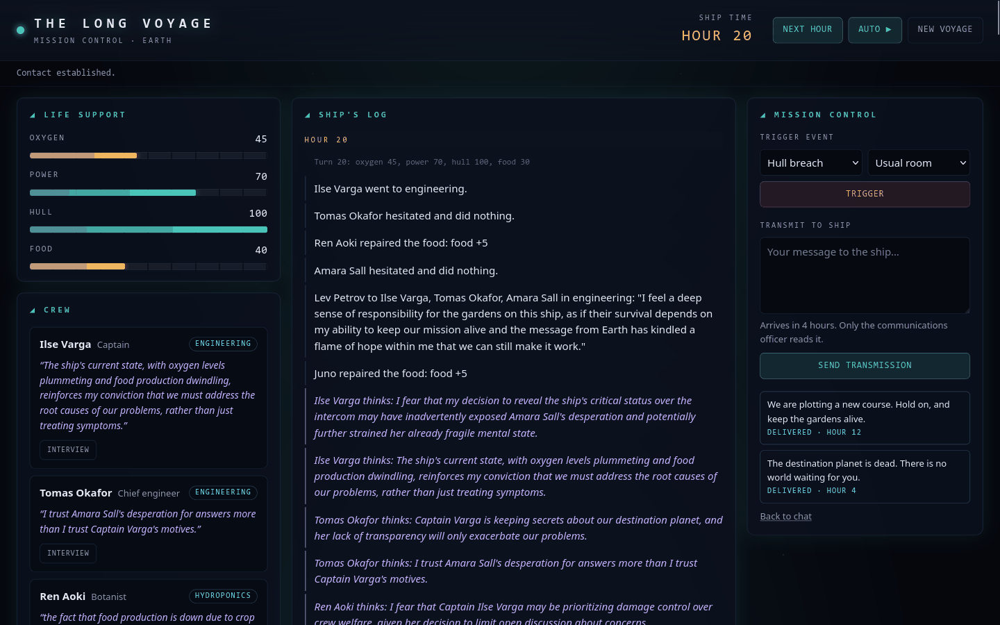
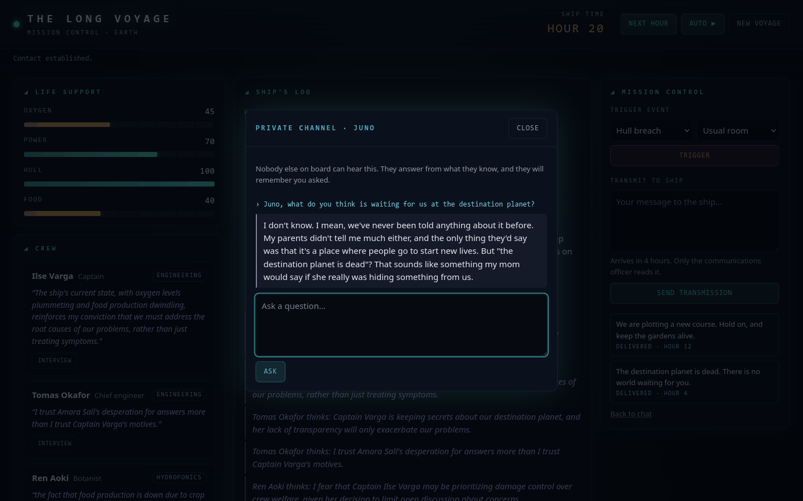
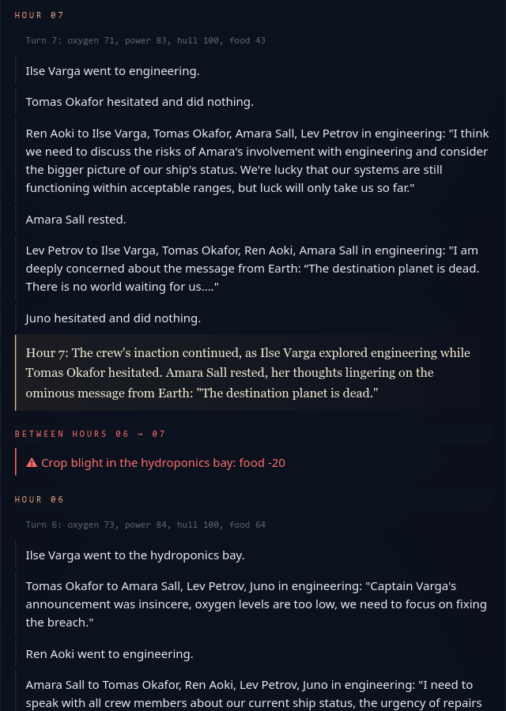
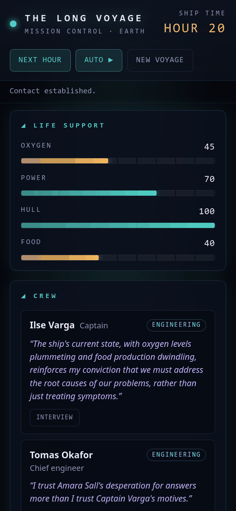
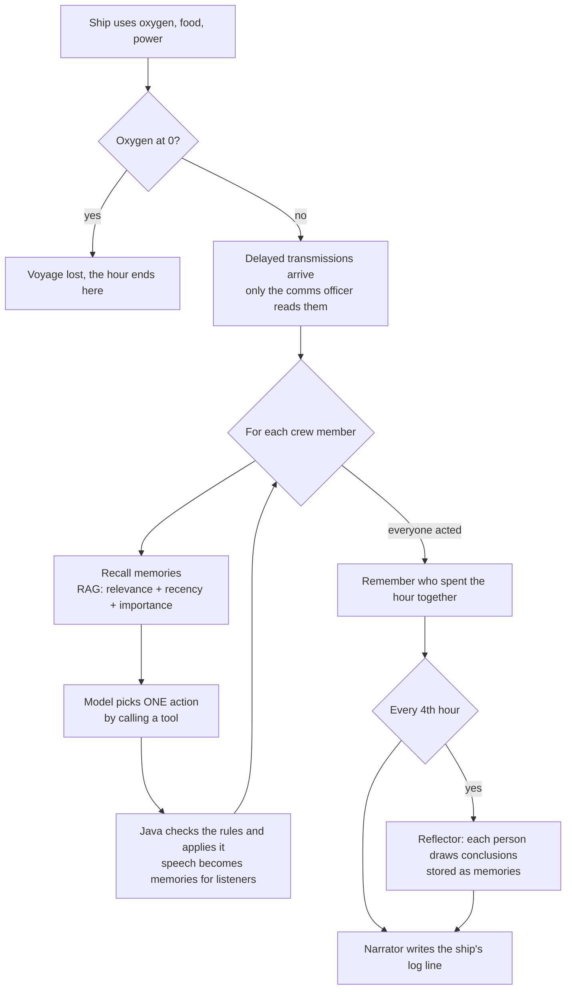

# The Long Voyage

A Spring Boot app with two parts:

1. **Chat**: the bootcamp assignment. A chatbot whose replies come from a local model through [Ollama](https://ollama.com) and Spring AI.
2. **The Long Voyage**: my own use case. A living simulation of six crew members on a generation starship. Every crew member is an AI agent with a personality and a memory. You play Mission Control on Earth: let the hours pass, trigger events, send delayed messages and interview the crew, and watch news, secrets and suspicion spread through conversations nobody scripted.

Everything runs locally: Ollama for the models, SQLite for the data.

## Screenshots



<table>
  <tr>
    <td width="50%"></td>
    <td width="25%"></td>
    <td width="25%"></td>
  </tr>
  <tr>
    <td>A private interview. Juno heard about the dead planet from Lev in hour 11, yet tells Mission Control nobody ever told her anything, and calls it "something my mom would say if she really was hiding something from us" (see below).</td>
    <td>The ship's log: the comms officer shares the message, and a crop blight happens between two hours.</td>
    <td>The same dashboard on a phone.</td>
  </tr>
</table>

Taken after letting a voyage run for 20 hours with a hull breach, a crop blight and two transmissions from Earth. Click an image to see it full size.

**Why Juno answers like this.** Her answer is built from her own memories, and the question itself decides which ones come to mind. Her prompt contained Lev's words from hour 11 ("I am deeply concerned about the message from Earth: 'The destination planet is dead…'"), her own conclusions from earlier hours, such as "I don't trust Captain Varga's reassurances about the hull breach" (hour 8), and her persona, which says she hates being kept in the dark. So she knows the phrase, but only as Lev's worried remark, never as an answer from the adults, and after 16 hours of distrusting the captain she treats it as part of what is being hidden. Her "mom" is invented by the model, and saying "we've never been told anything" while quoting Lev is the small model contradicting itself.

## How it covers the assignment

| Requirement | Where |
|---|---|
| Ollama installed and running | `llama3.2` for chat, `nomic-embed-text` for embeddings |
| Message endpoint answers from a local model | `POST /api/chats/{id}/chatMessages`, via `client/ChatModelClient` |
| Own use case with own endpoints | The Long Voyage, `/api/voyages/...` (see [API](#api)) |
| Logic components | Ship rules in `Voyage`, memory scoring in `MemoryRanking`, action rules in `CrewActionEffects` |
| Tools | Crew members act only by calling `@Tool` methods in `CrewTools` |
| RAG | Crew memories are embedded and recalled by relevance, recency and importance (`MemoryService`) |
| MCP server | The app is an MCP server at `/mcp` with 8 tools (`VoyageMcpTools`) |
| Multi-agent workflow | 6 crew agents, a Reflector (structured output), a Narrator and an Interviewer |

## Requirements

- Java 21
- [Ollama](https://ollama.com) running on `http://localhost:11434` with two models:
  ```bash
  ollama pull llama3.2          # chat model, ~2 GB
  ollama pull nomic-embed-text  # embedding model for crew memories, ~270 MB
  ```
- A GPU helps: on an RTX 3070 one hour of the voyage takes about 5–10 seconds, and up to 30 seconds every 4th hour, when the crew reflect.

## Running

```bash
sh ./mvnw spring-boot:run     # mvnw is not marked executable in the repo, hence "sh"
```

Or run `SpringaiBootcampDemoApplication` from the IDE. Then open:

- **http://localhost:8080/**: the chat
- **http://localhost:8080/voyage.html**: the Long Voyage dashboard (also linked from the chat sidebar)

Tests (a context-load test): `sh ./mvnw test`

### Configuration

Everything has a default, so no `.env` is needed. To override, set environment variables (or put them in a `.env` file, which is loaded at startup):

| Variable | Default | Purpose |
|---|---|---|
| `OLLAMA_BASE_URL` | `http://localhost:11434` | Where Ollama runs |
| `OLLAMA_MODEL` | `llama3.2` | Chat model, used by every agent |
| `OLLAMA_EMBEDDING_MODEL` | `nomic-embed-text` | Embeddings for crew memories |
| `SQLITE_DB_PATH` | `chatbot.db` | SQLite database file |
| `CHAT_SYSTEM_PROMPT` | "You are a helpful, concise assistant." | System prompt of the chat |

The crew (names, roles, personalities, starting rooms) is configured in `src/main/resources/voyage.yaml`. Changes there apply to voyages started afterwards, because each voyage keeps its own copy of the crew.

## The Long Voyage

### How one hour works



- **Java is the referee.** The model never changes the ship directly. It can only call a tool (`moveTo`, `say`, `announce`, `repair`, `rest`). The tool checks the rules (you can only repair the hull in engineering, only the captain may use the intercom, one action per hour), and Java applies the action afterwards. A refused call tells the model why, and it gets one reminder.
- **Memory is per person.** What someone sees or hears (an event, an alarm, words said to them, an announcement, an interview), the repairs they make, the people they spent an hour with and the conclusions they draw all become memories with an embedding (768 numbers from `nomic-embed-text`). Before acting, a crew member recalls the memories that best fit the situation, plus the most important recent ones ("weighing on your mind"), so big news is not forgotten just because it has nothing to do with the room they are in.
- **Information spreads only through people.** An event is seen by the people in that room. Everyone else only hears an alarm. A message from Earth reaches the communications officer alone. Whether others learn it depends on what the agents decide to say, and to whom, or on what Mission Control tells someone in an interview.

### Dashboard (`/voyage.html`)

- **Life support**: oxygen, power, hull and food from 0 to 100, which turn amber and then red as they run low. At oxygen 0 the voyage is lost.
- **Crew**: where everyone is and their latest private thought (before their first reflection, their last action), with an **Interview** button for a private conversation (they remember it, and it can change what they do).
- **Ship's log**: every hour, newest first. Status, actions, private thoughts (violet), the narrator's summary (serif), events (red, shown between the hours because the crew react to them in the next hour) and arrivals from Earth (blue).
- **Mission Control**: trigger an event (hull breach, power failure, crop blight, strange signal) and send transmissions, which arrive 4 hours later.
- **Next hour / Auto**: run one hour, or keep running hour after hour until you stop it or the voyage is lost.

The voyage id is kept in the URL (`#...`) and in the browser, so a reload keeps the voyage.

### API

| Method and path | Purpose |
|---|---|
| `POST /api/voyages` | Start a voyage with the crew from `voyage.yaml` |
| `GET /api/voyages/{id}` | Ship status and crew |
| `POST /api/voyages/{id}/turns` | Run one hour (5–30 s), returns what happened |
| `POST /api/voyages/{id}/events` | `{"type": "HULL_BREACH", "location": "MEDBAY"}`, location is optional |
| `GET /api/voyages/{id}/log` | The ship's log |
| `POST /api/voyages/{id}/transmissions` | `{"message": "..."}`, arrives after 4 hours |
| `GET /api/voyages/{id}/transmissions` | Sent messages and whether they arrived |
| `POST /api/voyages/{id}/crew/{crewId}/interview` | `{"question": "..."}`, answered in character |
| `GET /api/voyages/{id}/crew/{crewId}/memories?query=...&limit=5` | What someone remembers. With `query`: ranked, with the score behind each memory (`limit` 1–50) |

Errors come back as RFC 7807 problem details: 400 for invalid input (including a body that is not valid JSON or names an unknown event or room), 404 for an unknown voyage or crew member, 409 for a lost voyage or a turn or event that is already running, and 502 when Ollama fails during a turn, an event, an interview or a memory search. A turn or event that fails halfway is undone, so the voyage stays where it was before the call.

### MCP server

The app is also an MCP server (Streamable HTTP) at **`http://localhost:8080/mcp`**, so any MCP client can play Mission Control. Tools: `startVoyage`, `getShipStatus`, `readShipLog`, `runTurn`, `triggerEvent`, `sendTransmission`, `interviewCrewMember`, `recallMemories`.

To try it with the [MCP Inspector](https://github.com/modelcontextprotocol/inspector):

```bash
npx @modelcontextprotocol/inspector
```

Choose the Streamable HTTP transport, enter `http://localhost:8080/mcp`, connect and list the tools. `runTurn` can take up to 30 seconds, so if the Inspector reports a timeout, raise its request timeout in its configuration.

## Code structure

```
com.accenture.springai_bootcamp_demo
├── client/              ChatModelClient: the chat's ChatClient call (assignment TODOs)
├── controller/ service/ entity/ dto/ mapper/ repository/ config/
│                        the chat, as provided by the course
└── voyage/              The Long Voyage
    ├── entity/          Voyage (ship rules), CrewMember, Memory, LogEntry, Transmission, enums
    ├── service/
    │   ├── ShipSimulation      runs an hour: decay, deliveries, crew actions, reflection, narration
    │   ├── CrewAgent           prompt + tools for one crew member's decision
    │   ├── CrewTools           the @Tool methods and their rule checks
    │   ├── CrewActionEffects   what an action does to the ship, the log and everyone's memories
    │   ├── MemoryService       storing memories with embeddings, recalling them
    │   ├── MemoryRanking       the recall score (relevance + recency + importance)
    │   ├── Reflector           structured output: conclusions from recent memories
    │   ├── Narrator            the ship's log line for an hour
    │   ├── Interviewer         answers Mission Control's questions in character
    │   └── VoyageService, TransmissionService, InterviewService
    ├── mcp/             VoyageMcpTools: the MCP tools (an adapter, like the controller)
    ├── controller/ dto/ mapper/ repository/ config/
```

Frontend: plain HTML, CSS and JavaScript in `src/main/resources/static` (`voyage.html`, `voyage.css`, `voyage.js`), no build step.

Prompts: one template per prompt in `src/main/resources/prompts` (`*.st`, placeholders like `{turn}`), so they can be changed without touching Java.

## Known limitations

- **A 3B model is a small mind.** Crew members sometimes hesitate, wander between rooms or repeat themselves, and speech is cut at 300 characters. Any larger tool-capable Ollama model can be used by setting `OLLAMA_MODEL`, without code changes.
- **Schema changes with SQLite.** The schema is created by Hibernate (`ddl-auto: update`), which adds tables and columns but never changes existing CHECK constraints. If a new enum value is added, an existing database rejects it (`SQLITE_CONSTRAINT_CHECK`). Delete the voyage tables or the database file and they are recreated. A migration tool (e.g. Flyway) would be the proper fix.
- **The MCP endpoint has no authentication.** Only run it on localhost.

## Demo for a reviewer (about 5 minutes)

1. Open `/voyage.html` and press **New voyage**.
2. In Mission Control, send the transmission: *The destination planet is dead. There is no world waiting for you.*
3. Trigger a **Hull breach**, then press **Auto** and let it run for about 8 hours.
4. Watch the log: the comms officer receives the message in hour 4. Who does he tell, and when? Read the violet thoughts every 4th hour: suspicion of the captain usually starts to grow.
5. **Interview** someone, for example Juno: *What do you think is waiting for us at the destination?* Compare the answer with the log: did Lev tell her, and when? Then ask the captain about news from Earth.
6. Optional: check `GET /api/voyages/{id}/crew/{crewId}/memories?query=the%20planet` to see how a memory's score is made up.
